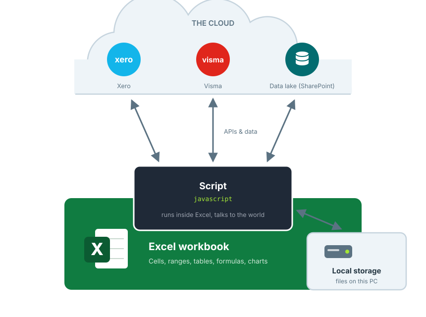

# Core Concepts

Everything in XLConnect revolves around a handful of concepts. Understand these and the rest of the documentation will fall into place.

<figure><figcaption>
Scripts move data between Excel, the cloud and local storage
</figcaption></figure>

## Connected workbooks

A connected workbook is a normal Excel workbook with XLConnect scripts and connections inside. Everything you know about Excel still applies — formulas, charts, formatting. XLConnect adds the ability to pull data in, push results out, and publish controlled versions to your users.

## Scripts

Scripts are javascript that lives in the workbook and runs inside Excel. A script reads its **inputs** from workbook cells and tables, does its work — calling cloud APIs, reading or writing the data lake, transforming data — and writes its **outputs** back to the workbook.

You rarely start from scratch: [import a prefab script](import-scripts.md) for your cloud platform and adapt it, or write your own in [Javascript Studio](javascript/javascript-studio.md). Users run scripts with the `Run` button on the ribbon — they never have to see the code.

## Modules

[Modules](../reference/modules/README.md) are re-usable pieces of javascript stored outside the workbook. They wrap the repetitive parts — HTTP calls, paging, authentication, serialization — so your scripts can focus on the business logic. There are modules for [HTTP](../reference/modules/http-module.md), the [SharePoint Data Lake](../reference/modules/spdl-module.md), and cloud systems like [Xero](../reference/modules/xero-module.md), [Visma](../reference/modules/visma-module.md) and [Exact](../reference/modules/exact-module.md).

## Cloud systems

[Cloud systems](cloud-systems.md) are the external platforms scripts talk to — Xero, Visma, Exact Online, HubSpot, Microsoft Graph and more. XLConnect comes 'batteries included' with the authentication flows built in: pass an `auth` parameter like `'xero'` and the login, token storage and refresh are handled for you.

## The data lake

Where your data is stored — as JSON files, without designing a database first. Data in the data lake is **shared between users**: save data from one workbook and a colleague loads it into theirs. That is how multi-user workflows are built — data flows through several workbooks, each adding its part, towards the final result.

The recommended option is the [SharePoint Data Lake](data-lake-sharepoint.md): your data stays on your own Office 365 subscription, SharePoint keeps version history, and the [spdl module](../reference/modules/spdl-module.md) has the easiest syntax. XLConnect also offers its [own data lake](data-lake-xlc.md), used by existing workbooks.

## Local storage

Scripts can also read and write files on the PC itself, in the XLConnect data folder (`AppData/XLConnect/Data`). Local storage is **shared between workbooks** on the same computer — but not with other users. That makes it the right place for caches and intermediate results: for example, the [Xero module](../reference/modules/xero-module.md) syncs journals to local files so repeated reporting pulls are fast and light on API rate limits.

Work with local files through the [FILE module](../reference/modules/file-module.md), or the raw [file methods on the xlc object](../reference/the-xlc-object.md#datalake).

## Publishing and versions

When a workbook is ready, `Save to Cloud` publishes it to the Model Library. Users open it through `Open Workbook` — they always get the intended version, and the `Workbook History` keeps every version with the ability to roll back. This replaces mailing spreadsheets around and wondering which copy is current.

## Automation

Anything a user can run, a machine can run too. With [Standalone mode](javascript/standalone-mode.md), scripts run outside Excel from a task scheduler — so hundreds of workbooks can be refreshed with new data overnight, and [VBA](vba.md) can drive XLConnect actions from buttons inside the workbook.
