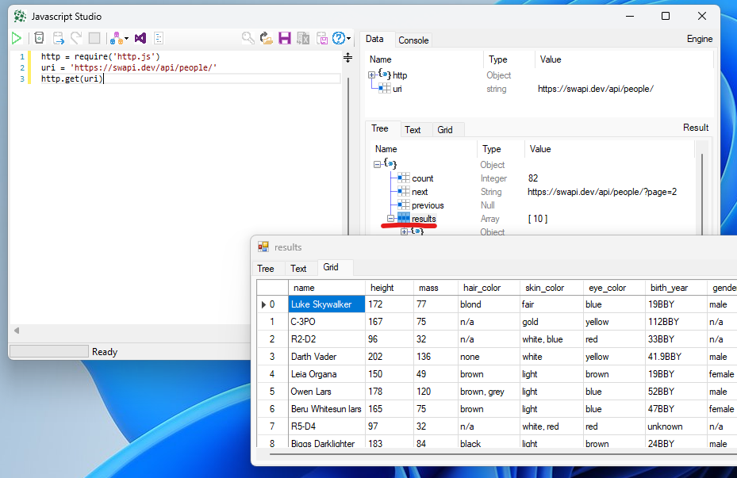

# Calling API's with HTTP Requests

The Language of the Web

You are probably already familiar with the Hyper Text Transfer Protocol (HTTP) as that is how your web browser talks to web servers over the internet to show you web pages. Your browser sends an http request to a web server, that responds with a http response with html data that will be rendered in your browser for you to read.&#x20;

This same technology can also be used to request and serve data, that better suited for programs to read. Instead of serving html they respond with data, typically json or xml. These are call Application Programming Interfaces or API's.&#x20;

XLConnect has a built in HTTP client that allows Excel to call these API's with minimal technical friction.&#x20;

## A sample Web request using XLConnect

In the [Javascript Studio](javascript-studio.md), this code will execute an HTTP request and display the data.&#x20;

Copy and paste it into a new Javascript Studio window and hit F5 to execute it.&#x20;

```
http = require('http.js')                // use the http module with wrapper methods 
uri = 'https://swapi.dev/api/people/'    // uri with details about starwars characters
sw = http.get(uri)                       // get the data and assign to sw variable 
```

This code grabs data (click [here ](https://swapi.dev/api/people/)to see the raw data) about Star Wars characters. Double click the `results` element to drill down to the actual characters.&#x20;

Please note this uses the [HTTP module GET](../../reference/modules/http-module.md) method that handles&#x20;

<figure><figcaption><p>GETting a uri and displaying the results. </p></figcaption></figure>

## Anatomy of an HTTP request

An HTTP request has three major parts:

1. The Unique Resource Identifier URI (sometimes also called URL for Locator)
2. The Headers
3. The Content&#x20;

API's have not really converged to a uniform way of using these elements to make it work, so be prepared to use all of them.&#x20;

### URI

You will have seen many uri's in your life, to make sure you understand exactly what each part means, below is a short summary.&#x20;

<figure><figcaption><p>Anatomy or a URI</p></figcaption></figure>

### Headers

Headers are key-value properties that be sent and received, this allows both client and server to add properties to a request. Xero for instance requires that every request has a property `xero-tenant-id` to indicate for which tenant the request is meant for. Another often used property is&#x20;

### Content

The Content of a web request is the actua thing you wat to send and/ or recieve, in today's
